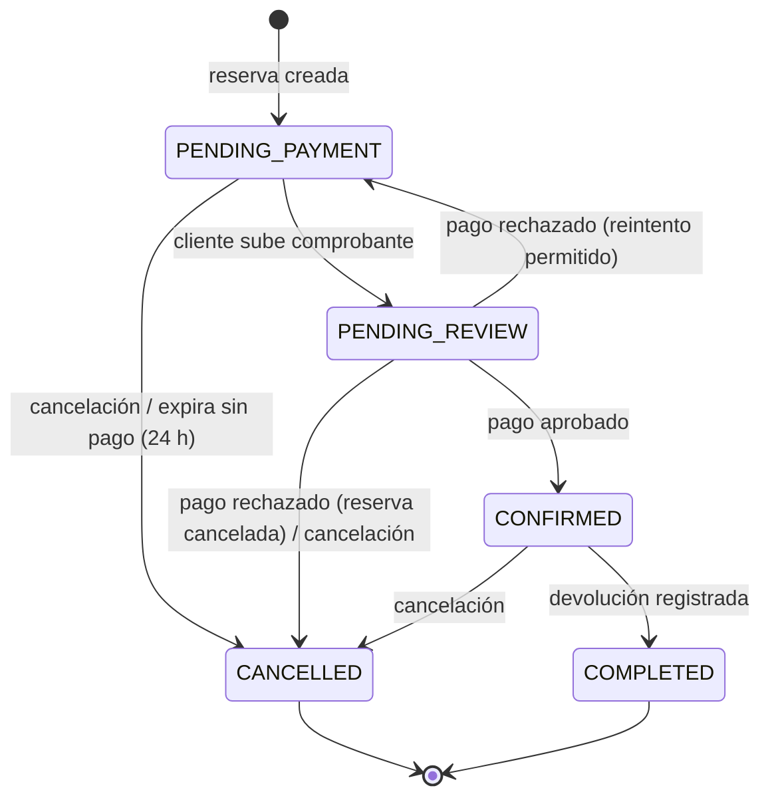

# rtm-booking-reservation

Microservicio **Booking & Reservation** de RentaMovil. Gestiona el ciclo de vida completo de un
alquiler de vehículo:

- **Reservas**: creación, consulta, modificación, cancelación y expiración automática.
- **Ejecución de la renta**: registro de la entrega (pickup) y la devolución del vehículo.
- **Notificaciones in-app**: avisos al cliente sobre su reserva, sus pagos y el mantenimiento.
- **Planes de seguro**: catálogo de seguros opcionales que se añaden a una reserva.

Son tres contextos de dominio desplegados como **un solo servicio**, porque comparten un único
ciclo de vida.

| | |
|---|---|
| Stack | Java 21 · Spring Boot 4.1 · Spring Data JPA · Maven |
| Arquitectura | Hexagonal (puertos y adaptadores) |
| Puerto | `3003` |
| Base de datos | SQL Server `rentamovil`, schema `booking`, usuario `booking_app` |
| Migraciones | En [`rtm-booking-db`](https://github.com/RentaMovil/rtm-booking-db) (Liquibase), no aquí |
| Autenticación | JWT RS256 emitido por `rtm-iam`, verificado con su clave pública |

## Contenido

- [Estado actual](#estado-actual)
- [Arquitectura](#arquitectura)
- [Ciclo de vida de una reserva](#ciclo-de-vida-de-una-reserva)
- [Requisitos](#requisitos)
- [Configuración](#configuración)
- [Ejecución local](#ejecución-local)
- [Ejecución con Docker](#ejecución-con-docker)
- [Endpoints](#endpoints)
- [Eventos de dominio](#eventos-de-dominio)
- [Tests](#tests)
- [Pendientes](#pendientes)
- [Ramas y contribución](#ramas-y-contribución)

## Estado actual

El servicio compila, valida su esquema contra la base al arrancar, pasa sus 25 tests de dominio y
expone todos sus endpoints. Están completos el modelo de dominio con sus invariantes, la máquina de
estados, el job de expiración, la verificación del JWT y el endpoint interno de ocupación.

**Crear una reserva todavía no es posible**, y es deliberado: el precio diario y la disponibilidad
del vehículo vienen del servicio `fleet-maintenance`, que aún no existe. En lugar de inventar un
precio, el servicio responde `409 FLEET_SERVICE_UNAVAILABLE`. Ver [Pendientes](#pendientes).

## Arquitectura

```
src/main/java/com/rentamovil/booking/
├── domain/                     Reglas de negocio. Sin Spring ni JPA
│   ├── entity/                   Reservation, Rental, Notification, InsuranceType, AuthenticatedUser
│   ├── enums/                    ReservationStatus, RentalStatus, NotificationType
│   ├── exception/                BusinessRuleException, InvalidDateRangeException, ...
│   └── port/
│       ├── in/                   Casos de uso (ReservationUseCases, RentalUseCases, ...)
│       └── out/                  Lo que el dominio necesita (*RepositoryPort, VehicleAvailabilityPort, ...)
├── application/usecase/        Implementación de los casos de uso
└── infrastructure/             Adaptadores
    ├── config/                   BeanConfig, WebConfig
    ├── events/                   InProcessEventDispatcher (eventos en memoria, sin broker)
    ├── fleet/                    PendingVehicleAvailabilityAdapter (provisional)
    ├── persistence/              Entidades JPA, repositorios Spring Data y adaptadores
    ├── scheduling/               ReservationExpirationJob
    ├── security/                 JwtKeyConfig, JwtVerifierAdapter
    └── web/                      Controladores, DTOs, @CurrentUser, manejo de errores, logging
```

Principios:

- **El dominio no depende de nada.** Los casos de uso hablan con el exterior solo a través de
  puertos; cambiar la base, el broker o el cliente de fleet es cambiar un adaptador.
- **El servicio no toca el esquema.** `spring.jpa.hibernate.ddl-auto=validate`: Hibernate solo
  comprueba al arrancar que las entidades coinciden con las tablas y falla si no. Todo cambio de
  esquema se hace primero como changeset en `rtm-booking-db`.
- **Nunca se conecta como `sa`.** Usa `booking_app`, que solo puede leer/escribir el schema
  `booking` e insertar en `shared.audit`.
- **Solo la clave pública de IAM.** El servicio verifica tokens, nunca los firma.
- **El `clientId` sale del token**, nunca del cuerpo de la petición ni de las respuestas: nadie
  puede reservar a nombre de otra persona.

## Ciclo de vida de una reserva



Reglas principales (las `INV-xxx` son los invariantes del dominio):

- `total_amount = vehicle_subtotal + insurance_subtotal` (INV-008).
- Como máximo un seguro por reserva; se cobra una vez por la duración total (INV-006, INV-007).
- La fecha de recogida y el vehículo no cambian; `end_date` solo se puede ampliar (INV-002, INV-003).
- Cancelar o cambiar la sucursal de devolución solo hasta 3 días antes de `end_date`
  (INV-004, INV-013).
- Una reserva sin pago aprobado se cancela sola pasado el plazo configurado (INV-015). Lo hace
  `ReservationExpirationJob`, que corre cada hora y registra la acción en auditoría como acción
  de sistema.

Una **renta** (`rental`) solo existe a partir del pickup: empieza en `IN_PROGRESS` y pasa a
`COMPLETED` al registrar la devolución con fecha y kilometraje final.

## Requisitos

- Java 21+
- Maven 3.9+
- Docker Desktop (opcional)
- SQL Server levantado y migrado, en este orden:
  1. [`rtm-iam-db`](https://github.com/RentaMovil/rtm-iam-db) — SQL Server, base `rentamovil` y tablas `iam.*`
  2. [`rtm-booking-db`](https://github.com/RentaMovil/rtm-booking-db) — schema `booking` y usuario `booking_app`

Orden para levantar todo el sistema:

```
rtm-iam-db → rtm-booking-db → rtm-iam → rtm-booking-reservation → rtm-api-gateway
```

## Configuración

```bash
cp .env.example .env    # el .env nunca se sube
```

| Variable | Descripción | Por defecto |
|---|---|---|
| `DATABASE_URL` | URL JDBC de SQL Server | `jdbc:sqlserver://localhost:1433;databaseName=rentamovil;...` |
| `DATABASE_USERNAME` | Usuario de base de datos | `booking_app` |
| `DATABASE_PASSWORD` | Igual a `parameter.bookingAppPassword` de `rtm-booking-db/liquibase.properties` | — |
| `APP_BOOKING_RESERVATION_PORT` | Puerto HTTP | `3003` |
| `APP_BOOKING_RESERVATION_JWT_PUBLIC_KEY` | Clave pública RS256 de IAM (PEM en base64, una línea). Es la misma que `APP_IAM_JWT_PUBLIC_KEY` de `rtm-iam` y la que publica `GET /jwks` | — |
| `APP_BOOKING_RESERVATION_PAYMENT_WINDOW_HOURS` | Horas que una reserva espera un pago aprobado antes de expirar | `24` |

`application.properties` carga el `.env` automáticamente en local. Las fechas se guardan en UTC.

## Ejecución local

```bash
mvn test                # tests
mvn spring-boot:run     # levanta el servicio en http://localhost:3003

curl http://localhost:3003/health
# {"status":"ok","db":"connected","timestamp":"..."}
```

`/health` responde `503` con `"db":"disconnected"` si la base no responde.

## Ejecución con Docker

Con las bases ya levantadas (ver [Requisitos](#requisitos)) y la red `rentamovil` creada:

```bash
docker compose up -d --build
```

- Contenedor `rentamovil-booking-reservation`, puerto `3003`, alias `booking-reservation` en la red
  (el gateway lo encuentra en `http://booking-reservation:3003`).
- Usa el mismo `.env`; `docker-compose.yml` solo sobrescribe `DATABASE_URL` para apuntar al
  contenedor `sqlserver`.
- Imagen multi-etapa: compila con Maven y corre en `eclipse-temurin:21-jre` con un usuario sin
  privilegios y `HEALTHCHECK` sobre `/health`.
- No uses a la vez `mvn spring-boot:run` y el contenedor: ambos ocupan el puerto 3003.

## Endpoints

| Método | Ruta | Auth | Historia | Respuestas |
|---|---|---|---|---|
| GET | `/health` | — | — | 200 · 503 |
| GET | `/insurance-plans` | — | HU-BOOKING-002 | 200 · 404 |
| POST | `/reservations` | Bearer | HU-BOOKING-003, 007 | 201 · 400 `INVALID_DATE_RANGE` / `TERMS_NOT_ACCEPTED` · 401 · 409 `FLEET_SERVICE_UNAVAILABLE` |
| GET | `/reservations/mine` | Bearer | HU-BOOKING-004 | 200 · 401 |
| GET | `/reservations/{id}` | Bearer | HU-BOOKING-004 | 200 · 401 · 403 |
| PATCH | `/reservations/{id}` | Bearer | HU-BOOKING-005 | 200 · 400 · 401 · 404 · 409 `RETURN_BRANCH_LOCKED` |
| POST | `/reservations/{id}/cancel` | Bearer | HU-BOOKING-006 | 200 · 401 · 404 · 409 `CANCELLATION_WINDOW_CLOSED` |
| POST | `/rentals/{reservationId}/pickup` | ADMIN | HU-RENTAL-001 | 201 · 401 · 403 · 404 · 409 `RESERVATION_NOT_CONFIRMED` / `RENTAL_ALREADY_STARTED` |
| POST | `/rentals/{id}/return` | ADMIN | HU-RENTAL-002 | 200 · 401 · 403 · 404 · 409 `INVALID_MILEAGE` |
| GET | `/notifications` | Bearer | HU-NOTIF-001 | 200 · 401 |
| PATCH | `/notifications/{id}/read` | Bearer | HU-NOTIF-001 | 200 · 401 · 404 |
| GET | `/admin/reservations?status=` | ADMIN | HU-BOOKING-008 | 200 · 401 · 403 |
| GET | `/admin/rentals` | ADMIN | — | 200 · 401 · 403 |
| POST | `/admin/insurance-plans` | ADMIN | HU-BOOKING-009 | 200 · 400 · 401 · 403 |
| GET | `/internal/reservations/vehicle-occupancy` | sin JWT | consumo interno de fleet | 200 · 400 |

`/internal/*` no lleva JWT a propósito: lo consume `fleet-maintenance`, no una persona. El
api-gateway **no debe** exponer `/internal/*` fuera de la red interna.

Ejemplo:

```bash
curl -X POST http://localhost:3003/reservations \
  -H "Authorization: Bearer <access_token>" \
  -H "Content-Type: application/json" \
  -d '{"vehicleId":301,"insuranceTypeId":1,"pickupBranchId":10,"returnBranchId":11,
       "startDate":"2026-11-01T10:00:00","endDate":"2026-11-05T10:00:00","termsAccepted":true}'
```

## Eventos de dominio

Por ahora no hay broker de mensajería: `InProcessEventDispatcher` entrega los eventos en memoria a
los listeners registrados. Cuando haya broker (Kafka, RabbitMQ...) solo se reemplaza ese adaptador.
Un listener que falla no detiene a los demás.

**Publica:** `ReservationCreated`, `ReservationCancelled`, `ReservationExpired`,
`ReservationReturnBranchChanged`, `ReservationReturnDateExtended`, `RentalStarted`,
`RentalCompleted`.

**Consume** (de forma idempotente): `PaymentCompleted`, `PaymentRejected`, `InvoiceGenerated`
(de `payment-billing`) y `MaintenanceCompleted` (de `fleet-maintenance`).

El estado del vehículo (`vehicle.status`) lo cambia `fleet-maintenance` al recibir
`RentalStarted` / `RentalCompleted`; este servicio nunca lo escribe.

## Tests

```bash
mvn test
```

25 tests unitarios del dominio (`ReservationTest`, `RentalTest`, `InsuranceTypeTest`) que cubren
invariantes, cálculo de totales y transiciones de estado. No necesitan base de datos.

## Pendientes

1. **Servicio `fleet-maintenance`.** Fuente del precio diario y la disponibilidad del vehículo
   (HU-FLEET-002). Mientras no exista, `PendingVehicleAvailabilityAdapter` responde
   `409 FLEET_SERVICE_UNAVAILABLE`. Cuando exista se consumirá
   `GET fleet-maintenance:3002/vehicles/{id}/availability?from=…&to=…`.
2. **FKs hacia fleet, telemetry y payment.** Las columnas ya existen (`vehicle_id`,
   `pickup_branch_id`, `return_branch_id`, `gps_id`, ...); las FKs se añadirán en `rtm-booking-db`
   cuando esos servicios estén migrados.
3. **Claim `personId` en el token.** `reservation.client_id` apunta a `iam.person`, así que el
   servicio necesita el `person_id` del titular. `JwtVerifierAdapter` ya lo lee y responde `401`
   con un mensaje claro si falta. Hay que añadirlo en `rtm-iam`
   (`JwtTokenProviderAdapter.generateAccessToken`); sin él, ningún endpoint autenticado funciona.

## Ramas y contribución

- `main`: versión estable.
- `develop`: integración.
- Ramas de trabajo `feat/…`, `fix/…`, `chore/…` → Pull Request a `develop` (Squash and Merge).
- `develop` se integra en `main` para cada versión.
