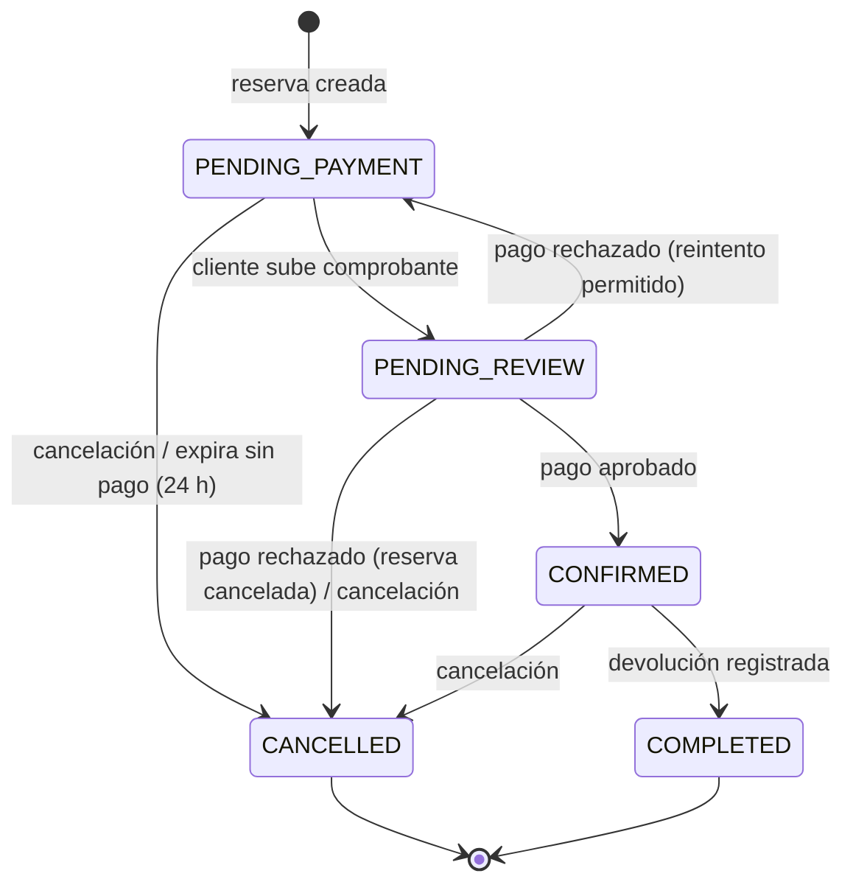

# rtm-booking-reservation

Microservicio **Booking & Reservation** de RentaMovil. Gestiona el ciclo de vida completo de un
alquiler de vehículo:

- **Reservas**: creación, consulta, cambio de sucursal de devolución, cancelación y expiración
  automática.
- **Ejecución de la renta**: registro de la entrega (pickup) y la devolución del vehículo.
- **Notificaciones in-app**: avisos al cliente sobre su reserva, sus pagos y el mantenimiento.
- **Planes de seguro**: catálogo de seguros opcionales que se añaden a una reserva.

Son tres contextos de dominio desplegados como **un solo servicio**, porque comparten un único
ciclo de vida.

| | |
|---|---|
| Stack | Java 21 · Spring Boot 4.1 · Spring Data JPA · Maven |
| Arquitectura | Hexagonal (puertos y adaptadores) |
| Puerto | `3003` |
| Base de datos | SQL Server `rentamovil`, schema `booking`, usuario `booking_app` |
| Migraciones | En [`rtm-booking-db`](https://github.com/RentaMovil/rtm-booking-db) (Liquibase), no aquí |
| Autenticación | JWT RS256 emitido por `rtm-iam`, verificado con su clave pública |

## Contenido

- [Estado actual](#estado-actual)
- [Arquitectura](#arquitectura)
- [Ciclo de vida de una reserva](#ciclo-de-vida-de-una-reserva)
- [Requisitos](#requisitos)
- [Configuración](#configuración)
- [Ejecución local](#ejecución-local)
- [Ejecución con Docker](#ejecución-con-docker)
- [Endpoints](#endpoints)
- [Eventos de dominio](#eventos-de-dominio)
- [Tests](#tests)
- [Probar el servicio](#probar-el-servicio)
- [Integración con otros servicios](#integración-con-otros-servicios)
- [Ramas y contribución](#ramas-y-contribución)

## Estado actual

Funciona de punta a punta con el frontend (a través del gateway) todo lo que depende solo de
booking: planes de seguro, consultar reservas, cancelar, cambiar la sucursal de devolución,
notificaciones, paneles de administración y la expiración automática.

Lo que todavía no funciona depende de servicios que aún no existen:

| Función | Depende de |
|---|---|
| Crear reservas (precio y disponibilidad del vehículo) | `fleet-maintenance` |
| Confirmar reservas (pago aprobado) y, por tanto, pickup y devolución en el flujo real | `payment-billing` y el canal de eventos entre servicios |
| Validar que una sucursal exista | `fleet-maintenance` |

Mientras `fleet-maintenance` no exista, crear una reserva responde `409 FLEET_SERVICE_UNAVAILABLE`
a propósito: el servicio no inventa precios. La sección
[Integración con otros servicios](#integración-con-otros-servicios) detalla qué cambia en este
código cuando cada uno exista.

Los endpoints con sesión requieren que el token de IAM incluya el claim `personId`
(rama `feat/ConectBooking` de `rtm-iam`).

## Arquitectura

```
src/main/java/com/rentamovil/booking/
├── domain/                     Reglas de negocio. Sin Spring ni JPA
│   ├── entity/                   Reservation, Rental, Notification, InsuranceType, AuthenticatedUser
│   ├── enums/                    ReservationStatus, RentalStatus, NotificationType
│   ├── exception/                BusinessRuleException, InvalidDateRangeException, ...
│   └── port/
│       ├── in/                   Casos de uso (ReservationUseCases, RentalUseCases, ...)
│       └── out/                  Lo que el dominio necesita (*RepositoryPort, VehicleAvailabilityPort, ...)
├── application/usecase/        Implementación de los casos de uso
└── infrastructure/             Adaptadores
    ├── config/                   BeanConfig, WebConfig
    ├── events/                   InProcessEventDispatcher (eventos en memoria, sin broker)
    ├── fleet/                    PendingVehicleAvailabilityAdapter (provisional)
    ├── persistence/              Entidades JPA, repositorios Spring Data y adaptadores
    ├── scheduling/               ReservationExpirationJob
    ├── security/                 JwtKeyConfig, JwtVerifierAdapter
    └── web/                      Controladores, DTOs, @CurrentUser, manejo de errores, logging
```

Principios:

- **El dominio no depende de nada.** Los casos de uso hablan con el exterior solo a través de
  puertos; cambiar la base, el broker o el cliente de flota es cambiar un adaptador.
- **El servicio no toca el esquema.** `spring.jpa.hibernate.ddl-auto=validate`: Hibernate solo
  comprueba al arrancar que las entidades coinciden con las tablas y falla si no. Todo cambio de
  esquema se hace primero como changeset en `rtm-booking-db`.
- **Nunca se conecta como `sa`.** Usa `booking_app`, que solo puede leer/escribir el schema
  `booking` e insertar en `shared.audit`. Los datos de otros servicios se piden por su API, nunca
  leyendo sus tablas.
- **Solo la clave pública de IAM.** El servicio verifica tokens, nunca los firma.
- **El `clientId` sale del token**, nunca del cuerpo de la petición ni de las respuestas: nadie
  puede reservar a nombre de otra persona.
- **Rutas bajo los prefijos del gateway.** El gateway solo enruta `/reservations/**`,
  `/rentals/**` y `/notifications/**` hacia este servicio, así que todo endpoint público vive bajo
  uno de ellos.

## Ciclo de vida de una reserva



Reglas principales (las `INV-xxx` son los invariantes del dominio):

- `total_amount = vehicle_subtotal + insurance_subtotal` (INV-008).
- Como máximo un seguro por reserva; se cobra una vez por la duración total (INV-006, INV-007).
- **De una reserva solo se modifica la sucursal de devolución.** Las fechas, el vehículo, la
  sucursal de recogida y el seguro quedan fijos desde que se crea, porque cambiarlos alteraría el
  precio ya calculado (INV-002).
- La sucursal de devolución se cambia hasta 3 días antes de `end_date` (INV-013), y solo en una
  reserva vigente: una cancelada o completada no se modifica.
- Cancelar es sin recargo, hasta 3 días antes de la fecha de **recogida** (`start_date`)
  (INV-004, INV-005).
- Una reserva sin pago aprobado se cancela sola pasado el plazo configurado (INV-015). Lo hace
  `ReservationExpirationJob`, que corre cada hora y registra la acción en auditoría como acción
  de sistema.

Una **renta** (`rental`) solo existe a partir del pickup: empieza en `IN_PROGRESS` y pasa a
`COMPLETED` al registrar la devolución con fecha y kilometraje final.

## Requisitos

- Java 21+
- Maven 3.9+
- Docker Desktop (opcional)
- SQL Server levantado y migrado, en este orden:
  1. [`rtm-iam-db`](https://github.com/RentaMovil/rtm-iam-db) — SQL Server, base `rentamovil` y tablas `iam.*`
  2. [`rtm-booking-db`](https://github.com/RentaMovil/rtm-booking-db) — schema `booking` y usuario `booking_app`

Orden para levantar todo el sistema:

```
rtm-iam-db → rtm-booking-db → rtm-iam → rtm-booking-reservation → rtm-api-gateway
```

## Configuración

```bash
cp .env.example .env    # el .env nunca se sube
```

| Variable | Descripción | Por defecto |
|---|---|---|
| `DATABASE_URL` | URL JDBC de SQL Server | `jdbc:sqlserver://localhost:1433;databaseName=rentamovil;...` |
| `DATABASE_USERNAME` | Usuario de base de datos | `booking_app` |
| `DATABASE_PASSWORD` | Igual a `parameter.bookingAppPassword` de `rtm-booking-db/liquibase.properties` | — |
| `APP_BOOKING_RESERVATION_PORT` | Puerto HTTP | `3003` |
| `APP_BOOKING_RESERVATION_JWT_PUBLIC_KEY` | Clave pública RS256 de IAM (PEM en base64, una línea). Es la misma que `APP_IAM_JWT_PUBLIC_KEY` de `rtm-iam` y la que publica `GET /jwks` | — |
| `APP_BOOKING_RESERVATION_PAYMENT_WINDOW_HOURS` | Horas que una reserva espera un pago aprobado antes de expirar | `24` |

`application.properties` carga el `.env` automáticamente en local. Las fechas se guardan y se
devuelven en UTC, sin zona horaria (`LocalDateTime`).

## Ejecución local

```bash
mvn test                # tests
mvn spring-boot:run     # levanta el servicio en http://localhost:3003

curl http://localhost:3003/health
# {"status":"ok","db":"connected","timestamp":"..."}
```

`/health` responde `503` con `"db":"disconnected"` si la base no responde.

## Ejecución con Docker

Con las bases ya levantadas (ver [Requisitos](#requisitos)) y la red `rentamovil` creada:

```bash
docker compose up -d --build
```

- Contenedor `rentamovil-booking-reservation`, puerto `3003`, alias `booking-reservation` en la red
  (el gateway lo encuentra en `http://booking-reservation:3003`).
- Usa el mismo `.env`; `docker-compose.yml` solo sobrescribe `DATABASE_URL` para apuntar al
  contenedor `sqlserver`.
- Imagen multi-etapa: compila con Maven y corre en `eclipse-temurin:21-jre` con un usuario sin
  privilegios y `HEALTHCHECK` sobre `/health`.
- No uses a la vez `mvn spring-boot:run` y el contenedor: ambos ocupan el puerto 3003.

## Endpoints

| Método | Ruta | Auth | Historia | Respuestas |
|---|---|---|---|---|
| GET | `/health` | — | — | 200 · 503 |
| GET | `/reservations/insurance-types` | — | HU-BOOKING-002 | 200 |
| POST | `/reservations/insurance-types` | ADMIN | HU-BOOKING-009 | 200 · 400 · 401 · 403 |
| POST | `/reservations` | Bearer | HU-BOOKING-003, 007 | 201 · 400 `INVALID_DATE_RANGE` / `TERMS_NOT_ACCEPTED` · 401 · 409 `FLEET_SERVICE_UNAVAILABLE` |
| GET | `/reservations/mine` | Bearer | HU-BOOKING-004 | 200 · 401 |
| GET | `/reservations/{id}` | Bearer | HU-BOOKING-004 | 200 · 401 · 403 |
| PATCH | `/reservations/{id}` | Bearer | HU-BOOKING-005 | 200 · 400 · 401 · 404 · 409 `RETURN_BRANCH_LOCKED` / `RESERVATION_NOT_MODIFIABLE` |
| POST | `/reservations/{id}/cancel` | Bearer | HU-BOOKING-006 | 200 · 401 · 404 · 409 `CANCELLATION_WINDOW_CLOSED` |
| GET | `/reservations/admin?status=` | ADMIN | HU-BOOKING-008 | 200 · 401 · 403 |
| POST | `/rentals/{reservationId}/pickup` | ADMIN | HU-RENTAL-001 | 201 · 401 · 403 · 404 · 409 `RESERVATION_NOT_CONFIRMED` / `RENTAL_ALREADY_STARTED` |
| POST | `/rentals/{id}/return` | ADMIN | HU-RENTAL-002 | 200 · 401 · 403 · 404 · 409 `INVALID_MILEAGE` |
| GET | `/rentals/in-progress` | ADMIN | — | 200 · 401 · 403 |
| GET | `/notifications` | Bearer | HU-NOTIF-001 | 200 · 401 |
| PATCH | `/notifications/{id}/read` | Bearer | HU-NOTIF-001 | 200 · 401 · 404 |
| GET | `/internal/reservations/vehicle-occupancy` | sin JWT | consumo interno de flota | 200 · 400 |

- `GET /reservations/insurance-types` es público: el cliente ve los planes antes de iniciar
  sesión. Con `startDate` y `endDate` devuelve además el costo total de cada plan para ese rango.
- `PATCH /reservations/{id}` solo acepta `newReturnBranchId`. Enviar `newEndDate` responde `400`:
  la fecha de devolución no se modifica.
- `/internal/*` no lleva JWT a propósito: lo consumen otros servicios, no personas. El api-gateway
  **no debe** exponer `/internal/*` fuera de la red interna.

Ejemplo:

```bash
curl -X POST http://localhost:3003/reservations \
  -H "Authorization: Bearer <access_token>" \
  -H "Content-Type: application/json" \
  -d '{"vehicleId":3,"insuranceTypeId":1,"pickupBranchId":1,"returnBranchId":2,
       "startDate":"2026-11-01T15:00:00","endDate":"2026-11-05T15:00:00","termsAccepted":true}'
```

## Eventos de dominio

Por ahora no hay broker de mensajería: `InProcessEventDispatcher` entrega los eventos en memoria a
los listeners registrados **dentro de este mismo proceso**. Todavía no salen hacia otros servicios
ni llegan desde ellos (ver [Integración con otros servicios](#integración-con-otros-servicios)).
Un listener que falla no detiene a los demás.

**Publica:** `ReservationCreated`, `ReservationCancelled`, `ReservationExpired`,
`ReservationReturnBranchChanged`, `RentalStarted`, `RentalCompleted`.

**Sabe procesar** (de forma idempotente, ya implementado en `PaymentEventUseCases`):
`PaymentCompleted`, `PaymentRejected`, `InvoiceGenerated` (de `payment-billing`) y
`MaintenanceCompleted` (de `fleet-maintenance`).

El estado del vehículo (`vehicle.status`) lo cambia `fleet-maintenance` al recibir
`RentalStarted` / `RentalCompleted`; este servicio nunca lo escribe.

## Tests

```bash
mvn test
```

26 tests unitarios del dominio (`ReservationTest`, `RentalTest`, `InsuranceTypeTest`) que cubren
invariantes, cálculo de totales, transiciones de estado y las reglas de modificación. No
necesitan base de datos.

## Probar el servicio

1. **Reglas:** `mvn test`.
2. **API:** con IAM y booking levantados y un token real de IAM, probar los endpoints (Postman o
   `curl`). Los planes de seguro se crean por la API.
3. **Datos de prueba:** lo que la API todavía no puede crear (reservas, por falta de flota) se
   inserta directamente en `booking.reservation`, respetando las restricciones de la tabla:
   `total_amount = vehicle_subtotal + insurance_subtotal`, `client_id` debe existir en
   `iam.person` y `status` debe ser uno de los cinco estados válidos. Esos scripts van fuera de las
   migraciones: son datos de prueba y no deben llegar a producción.

## Integración con otros servicios

Gracias a la arquitectura hexagonal, conectar un servicio nuevo **no cambia las reglas de
negocio**: ni las entidades, ni los casos de uso, ni los endpoints que usa el frontend. Se
reemplazan adaptadores provisionales por reales, se agregan adaptadores de entrada para recibir
avisos y se agregan las FKs pendientes en `rtm-booking-db`.

### Canal de eventos (afecta a todos los servicios)

Es la pieza central y se decide una sola vez para todo el sistema:

- **Salida:** reemplazar `InProcessEventDispatcher` por un adaptador que publique fuera del
  proceso (HTTP hacia endpoints internos de cada servicio, o un broker como RabbitMQ). Implementa
  el mismo `DomainEventPublisherPort`, así que todos los `events.publish(...)` de los casos de uso
  quedan iguales.
- **Entrada:** un adaptador de entrada (controlador `/internal/...` o listener del broker) que
  reciba los eventos de otros servicios y llame a `PaymentEventUseCases`.
- El gateway no cambia: `/internal/**` nunca se expone hacia afuera.

### `fleet-maintenance`

| Dónde | Qué cambia |
|---|---|
| `infrastructure/fleet/` | Reemplazar `PendingVehicleAvailabilityAdapter` (hoy responde 409) por un cliente REST que implemente el mismo `VehicleAvailabilityPort` y llame a `GET /vehicles/{id}/availability?from=…&to=…`. Borrar o desactivar el provisional: no puede haber dos implementaciones del puerto |
| `application.properties` / `.env.example` | URL de flota (`http://localhost:3002` en local, `http://fleet-maintenance:3002` en Docker) |
| Validar sucursales | Puerto nuevo (por ejemplo `BranchCatalogPort`) con su adaptador REST, y una línea en el caso de uso de cambio de sucursal para validar que exista. Opcional si basta con la FK |
| Eventos de entrada | `MaintenanceCompleted` → `onMaintenanceCompleted` (ya implementado) |
| Eventos de salida | Flota escucha `ReservationCreated`, `ReservationCancelled`, `ReservationReturnBranchChanged`, `RentalStarted` y `RentalCompleted` |
| `rtm-booking-db` | Changeset `04_alter/002_add_fks_fleet.sql`: FKs de `reservation.vehicle_id`, `pickup_branch_id`, `return_branch_id` y `notification.maintenance_id` |

Desbloquea: crear reservas, validar sucursales y las notificaciones de mantenimiento.

### `payment-billing`

| Dónde | Qué cambia |
|---|---|
| Adaptador de entrada nuevo | Recibe `PaymentCompleted`, `PaymentRejected` e `InvoiceGenerated` y llama a `PaymentEventUseCases`. La lógica de confirmar, rechazar y notificar ya está escrita y es idempotente |
| Lo que pagos necesita de booking | El total de la reserva para validar el monto: `GET /reservations/{id}` o un endpoint interno |
| `rtm-booking-db` | Changeset `04_alter/003_add_fks_payment.sql`: FKs de `notification.payment_id` y `notification.invoice_id` |

Desbloquea: confirmar reservas, las notificaciones de pago y, con eso, el pickup y la devolución
en el flujo real.

### `telemetry-gps`

| Dónde | Qué cambia |
|---|---|
| `rtm-booking-db` | Changeset con la FK `rental.gps_id → telemetry.gps` |
| Opcional | Puerto para validar en el pickup que el GPS exista y esté libre |
| Eventos de salida | Telemetría escucha `RentalStarted` / `RentalCompleted` para iniciar y terminar el rastreo |

### `rtm-iam`

Con el claim `personId` en el token no falta nada. Opcional: un puerto para pedir a IAM el nombre
y el correo del titular y mostrarlos en el panel de administración.

### Reglas para las FKs entre servicios

1. Las migraciones del servicio dueño corren **antes** que las de `rtm-booking-db`.
2. No pueden quedar datos huérfanos: si existe una reserva con `vehicle_id = 3`, `fleet.vehicle`
   debe tener el vehículo 3 o la FK falla al crearse.
3. `booking_app` no necesita permisos nuevos: la FK la valida el motor, no el usuario de la
   aplicación.
4. Un changeset ya aplicado nunca se edita: cada FK va en un changeset nuevo.

## Ramas y contribución

- `main`: versión estable.
- `develop`: integración.
- Ramas de trabajo `feat/…`, `fix/…`, `chore/…` → Pull Request a `develop` (Squash and Merge).
- `develop` se integra en `main` para cada versión.
